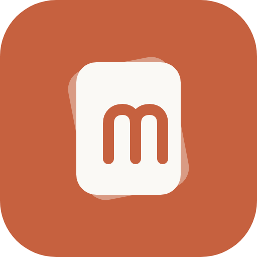
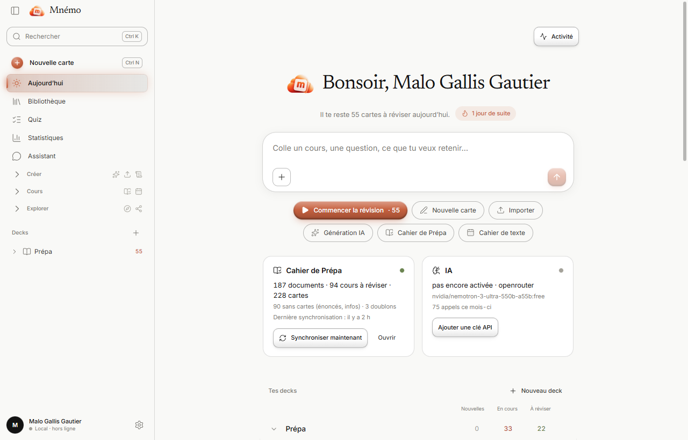
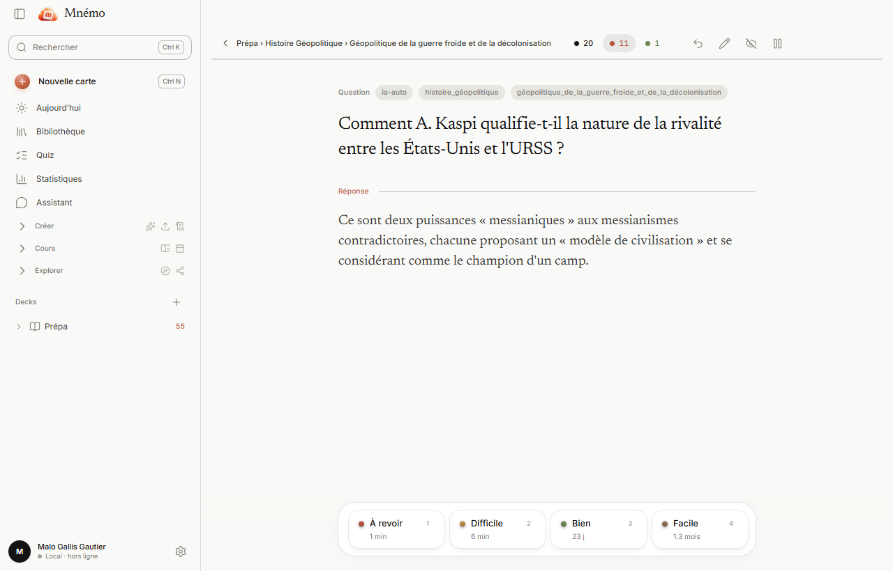
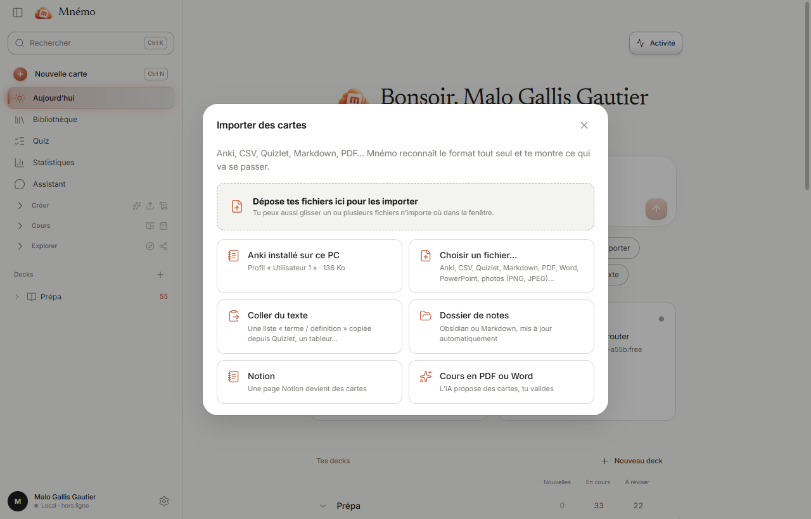
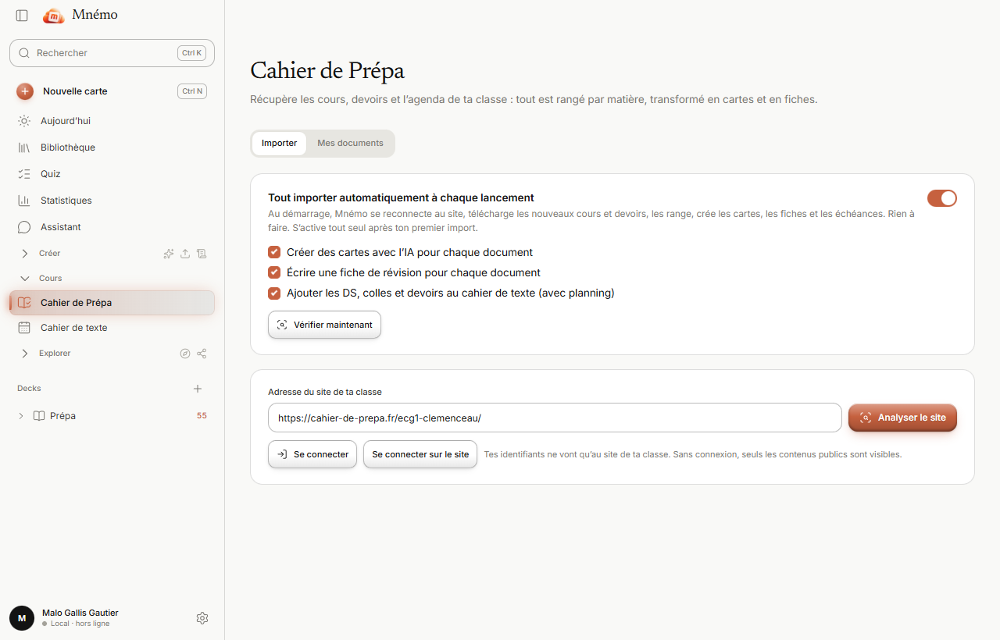
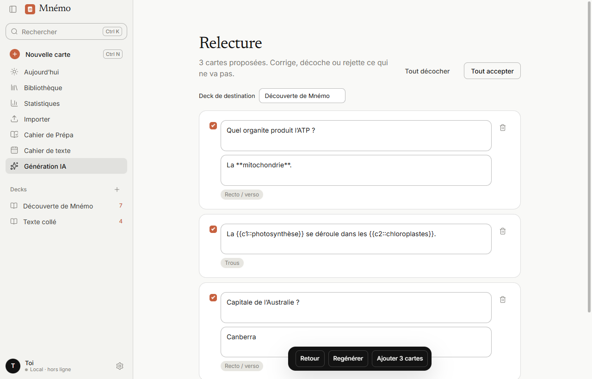
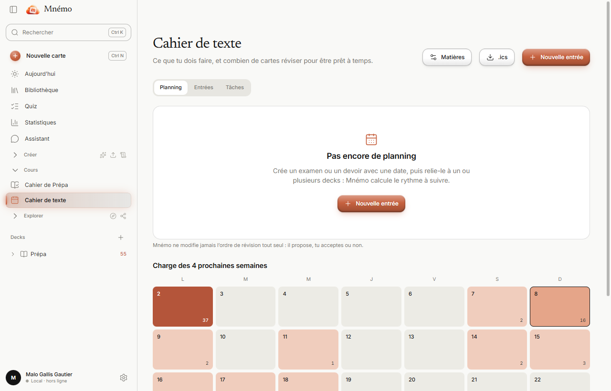

<p align="center"></p>

# Mnémo

**Une application de révision par cartes mémoire, gratuite, qui marche sans internet et sans compte.**
Tes cartes restent sur ton ordinateur. Elle remplace Anki avec une interface plus simple, une IA gratuite intégrée, et un import en un clic de tes cours depuis le **Cahier de Prépa**.



## ⬇️ Télécharger Mnémo

| Ton ordinateur | Clique ici |
| --- | --- |
| **Windows** | [**Télécharger pour Windows**](https://github.com/kusoooback/mnemo/releases/latest/download/mnemo-1.0.0-setup.exe) (`mnemo-1.0.0-setup.exe`) |
| **Mac récent** (puce Apple M1, M2, M3…) | [**Télécharger pour Mac (Apple)**](https://github.com/kusoooback/mnemo/releases/latest/download/mnemo-1.0.0-arm64.dmg) (`mnemo-1.0.0-arm64.dmg`) |
| **Mac plus ancien** (processeur Intel) | [**Télécharger pour Mac (Intel)**](https://github.com/kusoooback/mnemo/releases/latest/download/mnemo-1.0.0-x64.dmg) (`mnemo-1.0.0-x64.dmg`) |

Toutes les versions : [page des téléchargements](https://github.com/kusoooback/mnemo/releases/latest). Installation pas à pas, expliquée simplement : [Windows](#sur-windows-pas-à-pas) ou [Mac](#sur-mac-pas-à-pas).


> Projet libre et **non commercial** (licence MIT). Son interface s'inspire de celle de Claude par admiration pour son design : Mnémo n'a aucun lien avec Anthropic, n'utilise ni son nom ni son logo.

---

## 🔒 Vie privée : Mnémo ne récupère rien, jamais

**Mnémo est « privacy first » : tout reste sur ton ordinateur.** Le développeur n'a aucun serveur, aucune base de données et aucun moyen de voir ce que tu fais. Il ne reçoit rien de toi, et ne pourrait rien recevoir même s'il le voulait.

- **Pas de compte.** Pas d'inscription, pas d'adresse e-mail, pas de mot de passe pour utiliser Mnémo.
- **Pas de télémétrie.** Aucune statistique d'usage, aucun rapport de plantage, aucun traceur, aucune publicité, aucun outil d'analyse.
- **Pas de serveur à nous.** Aucune donnée n'est envoyée à l'auteur de Mnémo, ni à qui que ce soit d'autre, *par défaut*.
- **Pas de vérification de mise à jour cachée.** Mnémo ne se met pas à jour tout seul et ne « téléphone » pas pour demander s'il existe une nouvelle version. Tu télécharges toi-même la nouvelle version quand tu le décides.
- **Tout est stocké en local** : cartes, cours, notes, historique de révision, réglages, dans un dossier de ton ordinateur (voir [où sont mes données ?](#si-tu-veux-savoir-où-sont-tes-données)). Si tu supprimes Mnémo et ce dossier, il ne reste rien nulle part.
- **Fonctionne 100 % hors ligne.** Les polices, la reconnaissance de texte (OCR) et l'interface sont dans l'application. Tu peux couper internet : tout marche.
- **Open source (licence MIT).** Tu n'as pas à me croire sur parole : le code est ici, lisible par tout le monde. L'interface elle-même est verrouillée pour ne parler à aucun serveur externe (la politique de sécurité de la fenêtre n'autorise que les fichiers de l'application).

### Les seuls cas où Mnémo se connecte à internet

Et **uniquement parce que tu l'as demandé**, jamais en arrière-plan sans que tu aies activé la fonction :

| Fonction | Se connecte à | Ce qui est envoyé | Par défaut ? |
| --- | --- | --- | --- |
| **Télécharger le modèle d'IA intégré** (une seule fois, quand tu cliques sur *Télécharger et activer*) | Hugging Face (le site qui héberge le modèle) | Rien de toi : seulement la demande du fichier du modèle. Ensuite l'IA tourne **sur ton PC**, sans internet. | Non, sur clic |
| **Cahier de Prépa** (import et synchro de tes cours) | **Le site de ta classe**, à l'adresse que tu as saisie | Tes identifiants vont **uniquement** à ce site, comme dans un navigateur. Les cours téléchargés sont stockés chez toi. La synchro automatique ne s'active qu'après ton premier import manuel. | Non |
| **IA en ligne (optionnel)** : OpenRouter, Groq, Google Gemini, OpenAI, Claude… | Le fournisseur que **tu** as choisi, avec **ta propre clé** | Le texte que tu demandes de transformer en cartes ou en fiches. **Il quitte alors ton ordinateur.** Garde l'IA intégrée pour les documents confidentiels. | Non (IA intégrée par défaut) |
| **Ollama** (optionnel) | Ton propre ordinateur (`localhost`) | Rien ne sort de ta machine | Non |
| **Assistant, recherche web** (optionnelle, case à cocher dans la conversation) | Wikipédia, ou la page web dont tu donnes l'adresse | Les mots de la recherche (ou l'adresse de la page), rien d'autre. Ton cours n'est envoyé qu'à l'IA que tu as choisie (voir la ligne « IA en ligne ») | Non (case décochée) |
| **Ressources → Lire et créer des cartes** (sur clic) | Le site de la ressource sur laquelle tu cliques | Une seule requête pour télécharger cette page, sans identifiant ni cookie. Le texte lu n'est envoyé qu'à l'IA que tu as choisie (voir la ligne « IA en ligne ») | Non, sur clic |
| **Paquets → Catalogue communautaire** (facultatif) | `raw.githubusercontent.com` : le dossier [`community/`](community/) de ce dépôt public | Une requête pour la liste, puis une par paquet que tu ouvres, sans identifiant ni cookie. Comme pour tout site, GitHub voit l'adresse IP de la connexion. Chaque paquet est vérifié (empreinte, format, images) | Non, sur clic |
| **Connexion de Claude** (optionnel, [section 5](#brancher-claude-sur-mnémo)) | Rien : une « porte » locale (`127.0.0.1`) que **tu** ouvres | Rien ne sort de ta machine par Mnémo ; c'est le programme de Claude, sur ton PC, qui y dépose des cartes | Non (désactivée) |
| **Notion** (optionnel) | Notion, avec ton jeton | Ton jeton, pour **lire** les pages que tu importes (Mnémo n'écrit rien dans Notion) | Non |
| **Ouvrir un lien** (par exemple openrouter.ai, ou « Ouvrir » dans Ressources) | Ton navigateur habituel, quand tu cliques | Rien de la part de Mnémo | Sur clic |

À part ça : **aucune connexion**. Au premier lancement, tant que tu n'as rien activé de la liste ci-dessus, Mnémo ne contacte aucun serveur.

### Ce qui est protégé en plus

- Les **clés API et mots de passe** que tu enregistres sont chiffrés par le système (Windows / trousseau macOS) et jamais écrits en clair dans les fichiers de Mnémo.
- La **synchronisation entre deux ordinateurs** passe par un dossier que *tu* choisis (OneDrive, Dropbox, clé USB…) et le fichier est **chiffré** avec ta phrase secrète (AES-256) : même le service de stockage ne peut pas le lire.
- Les **sauvegardes** sont de simples fichiers sur ton disque.

### Comment le vérifier toi-même

- Coupe le Wi-Fi (ou mets ton PC en mode avion) : Mnémo fonctionne exactement pareil.
- Utilise le pare-feu de ton système pour lui interdire l'accès à internet : rien ne change tant que tu n'utilises pas les fonctions de la liste.
- Lis le code : tout est dans `src/`, et les seules adresses externes y figurent dans la liste ci-dessus.

> **Soyons honnêtes sur ce que cette promesse ne couvre pas** : Mnémo ne contrôle pas ce que font les sites que *tu* choisis d'utiliser (le site de ta classe, un fournisseur d'IA). Si tu utilises une IA en ligne, **leurs** règles de confidentialité s'appliquent à ce que tu leur envoies. Et Windows et macOS, eux, ont leurs propres communications avec leurs fabricants : c'est en dehors de Mnémo.

---

## Sommaire

0. [Vie privée : Mnémo ne récupère rien](#-vie-privée--mnémo-ne-récupère-rien-jamais)
1. [Installer Mnémo : guide pas à pas, Windows et Mac, même sans rien connaître](#1-installer-mnémo)
2. [Premiers pas en 3 minutes](#2-premiers-pas-en-3-minutes)
3. [Passer d'Anki (ou d'autre chose) à Mnémo](#3-passer-danki-ou-dautre-chose-à-mnémo)
4. [Récupérer ses cours du Cahier de Prépa](#4-récupérer-ses-cours-du-cahier-de-prépa)
5. [L'IA gratuite et illimitée](#5-lia-gratuite-et-illimitée)
6. [Partager, dessiner, personnaliser](#6-partager-dessiner-personnaliser)
7. [Le cahier de texte et la « garantie avant le DS »](#7-le-cahier-de-texte-et-la-garantie-avant-le-ds)
8. [Utiliser deux ordinateurs](#8-utiliser-deux-ordinateurs)
9. [Ça ne marche pas ?](#9-ça-ne-marche-pas-)
10. [Pour les développeurs](#10-pour-les-développeurs)

---

## 1. Installer Mnémo

> **Ce guide s'adresse à tout le monde**, même si tu n'as jamais installé un logiciel toute seule. Chaque étape dit *quoi cliquer* et *ce que tu dois voir*. Prends ton temps : il n'y a rien de dangereux, et tu ne peux rien casser.
> Compte **10 minutes** et environ **200 Mo** de téléchargement.

### En 5 lignes (si tu es pressée)

1. Ouvre la page des téléchargements : **https://github.com/kusoooback/mnemo/releases/latest** (c'est la page « Releases » du projet).
2. Télécharge **le bon fichier** : `…setup.exe` pour **Windows**, `…arm64.dmg` ou `…x64.dmg` pour **Mac**.
3. Ouvre le fichier téléchargé.
4. Si l'ordinateur dit « application non reconnue », choisis **« Exécuter quand même »** (Windows) ou **« Ouvrir quand même »** (Mac) : c'est normal, expliqué plus bas.
5. Lance **Mnémo** depuis le bureau (Windows) ou le dossier Applications (Mac).

Les explications détaillées commencent juste en dessous. Suis ton ordinateur : **[Windows](#sur-windows-pas-à-pas)** ou **[Mac](#sur-mac-pas-à-pas)**.

---

### Avant de commencer

**1. Quel est ton ordinateur ?**

| Si ton ordinateur… | C'est un… |
| --- | --- |
| a un logo **Windows** (4 carreaux) sur le clavier ou au démarrage, une barre avec le bouton ⊞ en bas de l'écran | **Windows** → [va ici](#sur-windows-pas-à-pas) |
| est un **MacBook, iMac, Mac mini** (une pomme en haut à gauche de l'écran) | **Mac** → [va ici](#sur-mac-pas-à-pas) |
| est un Chromebook, une tablette ou un téléphone | **Pas pris en charge** pour le moment |

**2. Ton ordinateur est-il assez récent ?** Mnémo demande **Windows 10 ou 11** (64 bits, c'est le cas de presque tous), ou **macOS 12 (Monterey) ou plus récent** sur Mac. Pour le savoir sur Mac : clique sur la pomme en haut à gauche → **À propos de ce Mac**.

**3. Il faut internet** pour télécharger le fichier. Une fois Mnémo installé, **il marche sans internet** (seuls l'IA en ligne et le Cahier de Prépa en ont besoin).

**4. Pas besoin de compte, ni de mot de passe, ni de payer quoi que ce soit.** Si une page te demande de l'argent ou de créer un compte pour télécharger Mnémo, ce n'est pas la bonne page : **ferme-la**.

---

### Étape 1 — Trouver et télécharger le fichier (Windows et Mac)

Mnémo se télécharge depuis une page du site **GitHub**, où les développeurs de logiciels libres mettent leurs fichiers. Tu n'as **pas besoin de compte GitHub** pour télécharger.

1. Ouvre **https://github.com/kusoooback/mnemo/releases/latest** (ou, sur la page principale du projet, clique sur **Releases** dans la colonne de droite).
2. Tu arrives sur une page avec un titre du genre **« v1.0.0 »** (le numéro de la version). Si plusieurs versions sont listées, prends **la première**, tout en haut : c'est la plus récente.
3. **Descends** avec la molette de la souris jusqu'à la rubrique **« Assets »** (parfois écrit **« Fichiers »**). Si on ne voit que « Assets » avec une petite flèche ▸, **clique dessus** pour déplier la liste.
4. Tu vois une liste de fichiers. **Choisis un seul fichier**, selon ton ordinateur :

| Ton ordinateur | Le fichier à cliquer | Ce qu'il y a au milieu du nom |
| --- | --- | --- |
| **Windows** | `mnemo-1.0.0-setup.exe` | `setup.exe` à la fin |
| **Mac récent** (acheté depuis fin 2020, puce « Apple M1, M2, M3… ») | `mnemo-1.0.0-arm64.dmg` | `arm64` et `.dmg` |
| **Mac plus ancien** (processeur « Intel ») | `mnemo-1.0.0-x64.dmg` | `x64` et `.dmg` |

   *Comment savoir pour le Mac ?* Clique sur la pomme → **À propos de ce Mac**. Si tu lis **« Puce : Apple M… »**, prends `arm64`. Si tu lis **« Processeur : Intel… »**, prends `x64`.
   *Les numéros peuvent être différents (1.0.1, 1.2…) : ce n'est pas grave, regarde seulement la fin du nom.*
   Ne clique pas sur « Source code (zip) » ni « Source code (tar.gz) » : ce sont les fichiers des programmeurs, pas l'application.

5. Le téléchargement démarre. Selon ton navigateur, tu vois une petite barre de progression **en bas** ou **en haut à droite** de la fenêtre. Attends qu'elle ait fini (1 à 5 minutes).
6. **Si ton navigateur affiche « Ce type de fichier peut endommager votre appareil » ou « Conserver ? »** : c'est un message automatique pour tous les fichiers de ce genre. Clique sur **Conserver** (ou « Garder »). Le fichier vient de la page officielle que tu as ouverte, tu peux le garder.

Le fichier est maintenant dans le dossier **Téléchargements** de ton ordinateur.

---

### Sur Windows, pas à pas

**Étape 2 — Ouvrir le fichier**

1. Ouvre le dossier **Téléchargements** : clique sur l'icône jaune en forme de **dossier** dans la barre en bas de l'écran (« Explorateur de fichiers »), puis sur **Téléchargements** dans la liste de gauche. *(Ou clique sur la flèche de téléchargement de ton navigateur, puis sur le nom du fichier.)*
2. Repère le fichier **`mnemo-…-setup.exe`** (le plus récent est en haut). **Double-clique** dessus (deux clics rapides avec le bouton gauche).

**Étape 3 — Le grand écran bleu « Windows a protégé votre ordinateur »**

Très probablement, une fenêtre **bleue** apparaît avec ce titre. **Ne panique pas, c'est normal.** Windows dit ça pour *tous* les logiciels qui n'ont pas payé une signature à Microsoft. Mnémo est gratuit et libre : ses développeurs ne la paient pas.

1. Clique sur le petit texte **« Informations complémentaires »** (juste sous le message, en bleu clair).
2. Un bouton **« Exécuter quand même »** apparaît en bas de la fenêtre. Clique dessus.

> *Tu n'as pas cette fenêtre ?* Parfait, passe à l'étape suivante.
> *Une autre fenêtre demande « Voulez-vous autoriser cette application à apporter des modifications ? »* → clique sur **Oui**.

**Étape 4 — L'assistant d'installation**

Une fenêtre d'installation s'ouvre, **en français**. Tu peux presque toujours cliquer sur **Suivant** (ou **Installer**) sans rien changer :

1. Si on te demande **« Pour qui installer ? »** : laisse **« Seulement pour moi »** et clique **Suivant**.
2. On te propose un **dossier de destination** : ne touche à rien, clique **Installer**.
3. Une barre verte avance pendant une ou deux minutes. Attends.
4. Quand c'est fini, clique sur **Terminer**. Une case **« Lancer Mnémo »** est peut-être cochée : laisse-la cochée.

**Étape 5 — Lancer Mnémo**

- Une icône **Mnémo** (un carré rouge brique) est maintenant **sur le bureau**. **Double-clique** dessus.
- Si tu ne la trouves pas : clique sur le bouton **⊞ Windows** en bas à gauche, tape **Mnemo** au clavier, puis clique sur le résultat.

La première ouverture peut prendre **quelques secondes de plus** que d'habitude : c'est normal.

**Si Windows affiche en plus une fenêtre « Pare-feu Windows Defender »** : Mnémo ne se connecte pas à internet pour fonctionner. Tu peux cliquer sur **Annuler**, ou sur **Autoriser l'accès** si tu veux utiliser l'IA en ligne ou le Cahier de Prépa. Les deux marchent.

[Passe directement à « Premier lancement »](#premier-lancement-windows-et-mac).

---

### Sur Mac, pas à pas

**Étape 2 — Ouvrir le fichier**

1. Le fichier `.dmg` est dans **Téléchargements**. Pour l'ouvrir : clique sur l'icône **Finder** (le visage bleu et blanc, tout à gauche du Dock en bas de l'écran), puis sur **Téléchargements** dans la colonne de gauche.
2. **Double-clique** sur **`mnemo-…-arm64.dmg`** (ou `x64`). Une petite fenêtre s'ouvre, avec **l'icône de Mnémo** à gauche et un **dossier « Applications »** à droite.

**Étape 3 — Installer**

1. **Glisse** l'icône **Mnemo** vers le dossier **Applications**, en gardant le bouton de la souris appuyé, puis lâche. (C'est comme ranger un papier dans un classeur.)
2. Attends que la copie finisse (quelques secondes). Tu peux ensuite fermer la petite fenêtre et **éjecter** le disque : dans le Finder, à gauche, clique sur la petite flèche ⏏ à côté de « Mnemo ».

**Étape 4 — Premier lancement : le Mac va refuser, et c'est normal**

Apple demande 99 $ par an aux développeurs pour « signer » leur application. Mnémo étant gratuit et libre, il n'est **pas signé** : ton Mac le signale par prudence, **mais il ne se passe rien de dangereux**. Il faut lui dire une seule fois que tu fais confiance à Mnémo.

1. Ouvre le **Finder** → **Applications** (dans la colonne de gauche).
2. Fais un **double-clic** sur **Mnemo**. Un message apparaît, selon la version de ton Mac :
   - « **Mnemo ne peut pas être ouvert car son développeur ne peut pas être vérifié** », ou
   - « **Apple n'a pas pu vérifier que Mnemo ne contient pas de logiciel malveillant** », ou
   - « **Mnemo est endommagé et ne peut pas être ouvert** ».
3. **Ne clique pas** sur « Placer dans la corbeille ». Clique sur **OK** (ou **Annuler**).
4. Maintenant, selon ton Mac :

   **Mac avec macOS 15 (Sequoia) ou plus récent** *(le plus courant sur les Mac récents)*
   1. Clique sur la pomme → **Réglages Système**.
   2. Dans la colonne de gauche, clique sur **Confidentialité et sécurité**.
   3. **Descends tout en bas** de la page, jusqu'à la rubrique **Sécurité** : tu lis « **« Mnemo » a été bloqué…** ».
   4. Clique sur le bouton **« Ouvrir quand même »**.
   5. Ton Mac te demande le **mot de passe de ta session** (celui que tu tapes au démarrage) ou ton **doigt (Touch ID)**. Donne-le, puis clique sur **Ouvrir**.

   **Mac avec macOS 14 (Sonoma), 13 (Ventura) ou 12 (Monterey)**
   1. Dans **Applications**, fais un **clic droit** sur **Mnemo** (clic avec deux doigts sur le pavé tactile, ou touche **ctrl** appuyée + clic).
   2. Dans le petit menu, clique sur **Ouvrir**.
   3. Dans la fenêtre qui s'affiche, clique à nouveau sur **Ouvrir**.

   **Si le message dit « endommagé » et qu'il n'y a pas de bouton « Ouvrir quand même »** : l'application n'est pas abîmée, c'est le même réflexe de prudence. Ouvre l'app **Terminal** (clique sur la loupe 🔍 en haut à droite, tape **Terminal**, appuie sur Entrée), **copie** la ligne ci-dessous, **colle-la** dans la fenêtre (touches **⌘ + V**) et appuie sur **Entrée** :

   ```
   xattr -dr com.apple.quarantine /Applications/Mnemo.app
   ```

   Il ne s'affiche rien : c'est normal. Ferme Terminal, puis double-clique à nouveau sur **Mnemo** dans Applications.

5. **Tu n'auras plus jamais à refaire ça** : les ouvertures suivantes sont normales.

**Étape 5 — Lancer Mnémo les fois suivantes**

- Dans le **Finder** → **Applications** → double-clic sur **Mnemo**.
- Plus rapide : appuie sur **⌘ + Espace**, tape **Mnemo**, appuie sur Entrée.
- Pour le garder dans le **Dock** (la barre d'icônes du bas) : une fois l'app ouverte, fais un clic droit sur son icône dans le Dock → **Options** → **Garder dans le Dock**.

**Pour demander la permission d'accès aux dossiers** : si ton Mac demande « Mnemo souhaite accéder aux fichiers de votre dossier Documents/Téléchargements », clique sur **OK** : c'est utile pour importer tes cours ou enregistrer un PDF.

---

### Premier lancement (Windows et Mac)

La première fois, Mnémo affiche un écran d'accueil qui te propose **trois choses, toutes facultatives** :

1. **Importer un paquet de cartes** (si tu venais d'Anki) ;
2. **Synchroniser deux ordinateurs** ;
3. **Activer l'IA** (qui fabrique des cartes à ta place).

**Le plus simple pour commencer** : clique sur **« Essayer avec un deck d'exemple »**. Mnémo crée quelques cartes pour que tu voies comment ça marche, puis clique sur **« Commencer la révision »**. Tu peux tout supprimer ensuite.

**Ce que tu dois voir** : une fenêtre claire avec, à gauche, une **barre latérale** (Aujourd'hui, Bibliothèque, Statistiques…) et, au milieu, un message « **Bonjour** » avec une grande zone de saisie.

Continue ensuite avec la [section 2 : Premiers pas](#2-premiers-pas-en-3-minutes).

---

### Mettre Mnémo à jour

Mnémo ne se met pas à jour tout seul. Quand on t'annonce une nouvelle version :

1. Retourne sur la page **Releases** et **télécharge le nouveau fichier** exactement comme à l'étape 1.
2. **Ferme Mnémo** (clique sur la croix ✕ de la fenêtre ; sur Mac, fais **⌘ + Q**).
3. Ouvre le nouveau fichier et refais l'installation : sur Windows, double-clic sur le `setup.exe` ; sur Mac, glisse **Mnemo** dans **Applications** et clique sur **Remplacer**.

**Tes cartes, tes cours et tes réglages sont conservés** : ils sont rangés à part, l'installation n'y touche pas.

### Désinstaller Mnémo

- **Windows** : clique sur ⊞ → **Paramètres** (la roue crantée) → **Applications** → **Applications installées** (sur Windows 10 : **Applications et fonctionnalités**) → trouve **Mnémo** → clique sur les trois points **⋯** → **Désinstaller**.
- **Mac** : ouvre **Applications**, **glisse Mnemo dans la Corbeille** (ou clic droit → **Placer dans la corbeille**).

**Tes cartes ne sont pas supprimées** par la désinstallation : c'est voulu, pour ne rien perdre si tu réinstalles. Pour **tout** effacer, supprime aussi le dossier de données :
- Windows : dossier `C:\Users\<ton nom>\AppData\Roaming\Mnemo`
- Mac : dossier `Bibliothèque/Application Support/Mnemo` (dans le Finder : menu **Aller** → touche **⌥ (option)** appuyée → **Bibliothèque**).

---

### Ça ne s'installe pas ? Les cas les plus fréquents

| Ce que tu vois | Ce que ça veut dire | Ce qu'il faut faire |
| --- | --- | --- |
| Rien ne se passe quand je double-clique sur le fichier (Windows) | Windows met parfois quelques secondes à réagir | Attends 10 secondes. Sinon, clic droit sur le fichier → **Ouvrir**. |
| Pas de bouton « Exécuter quand même » (Windows) | Il faut d'abord cliquer sur le texte **« Informations complémentaires »** | Clique dessus : le bouton apparaît juste après. |
| Mon antivirus bloque ou supprime le fichier | Les antivirus se méfient des logiciels peu connus | Ouvre ton antivirus, remets le fichier en « autorisé » ou « exclu », puis relance. Si tu hésites, demande à la personne qui t'a donné ce guide. |
| Le fichier se télécharge en `.crdownload` ou `.part` | Le téléchargement n'est pas fini | Attends la fin de la barre de progression, puis relance. |
| « Mnemo est endommagé » (Mac) | Réflexe de prudence de macOS, pas un vrai dommage | Utilise la ligne **Terminal** de l'étape 4 ci-dessus. |
| Je n'ai pas de bouton « Ouvrir quand même » (Mac) | Il n'apparaît qu'**après** avoir essayé d'ouvrir l'app une première fois | Fais d'abord un double-clic sur Mnemo dans Applications, **puis** va dans Réglages Système → Confidentialité et sécurité. |
| Je ne vois pas le dossier « Applications » dans la petite fenêtre (Mac) | La fenêtre du `.dmg` est trop petite | Dans le **Finder**, clique sur **Applications** à gauche, et glisse-y **Mnemo** depuis la petite fenêtre. |
| Il n'y a pas de fichier `.exe` ou `.dmg` sur la page Releases | La version n'a pas encore été publiée | Utilise la méthode de secours juste en dessous, ou demande à la personne qui t'a envoyé le lien. |
| Autre chose | | Voir « **Demander de l'aide** » ci-dessous. |

### Demander de l'aide (sans se tromper)

Envoie un message à la personne qui t'a donné ce guide, avec :

1. **Ton ordinateur** : Windows ou Mac (et, si tu sais, son âge ou le modèle) ;
2. **Une capture d'écran** de ce qui s'affiche. *Windows : touches ⊞ + Maj + S, puis dessine un rectangle autour du message, puis colle-le dans ton message avec Ctrl + V. Mac : touches ⌘ + Maj + 4 pour choisir une zone, ou ⌘ + Maj + 3 pour tout l'écran (l'image apparaît sur le bureau).*
3. **L'étape où tu es bloquée** (par exemple « étape 4, Mac, le message dit *endommagé* »).

Avec ça, on peut presque toujours te répondre du premier coup.

---

### Méthode de secours — Si la page Releases n'a pas de fichier prêt

Cette méthode est **un peu plus longue** (5 à 10 minutes, avec internet) et sert seulement si aucun fichier `.exe` ou `.dmg` n'est proposé. Elle installe d'abord un outil (« Node.js ») puis prépare Mnémo à partir de ses fichiers de départ.

**Sur Windows**

1. Sur la page principale du projet, clique sur le bouton vert **`< > Code`**, puis sur **Download ZIP**. Un fichier se télécharge.
2. Dans **Téléchargements**, fais un **clic droit** sur ce fichier ZIP → **Extraire tout…** → **Extraire**. Un dossier s'ouvre.
3. Ouvre le dossier extrait, puis le dossier **`mnemo`** qu'il contient.
4. **Double-clique** sur **`INSTALLER-MNEMO.bat`**. Si Windows affiche l'écran bleu « Windows a protégé votre ordinateur », fais comme à l'étape 3 plus haut.
5. Une **fenêtre noire** s'ouvre et prépare tout. **Ne la ferme pas**, laisse-la travailler (2 à 5 minutes). S'il manque *Node.js*, elle l'installe : **ferme alors la fenêtre noire** puis **double-clique à nouveau** sur `INSTALLER-MNEMO.bat`.
6. À la fin, Mnémo s'ouvre. Les fois suivantes : double-clic sur **`LANCER-MNEMO.bat`**.

**Sur Mac**

1. Même début : bouton vert **Code** → **Download ZIP**, puis double-clique sur le ZIP téléchargé pour le décompresser, et ouvre le dossier **`mnemo`**.
2. Il faut d'abord **Node.js** : va sur **nodejs.org**, clique sur le gros bouton vert **« LTS »**, ouvre le fichier téléchargé et suis l'installation (Continuer, Continuer, Installer, mot de passe de ta session).
3. Ouvre l'app **Terminal** (loupe 🔍 en haut à droite, tape **Terminal**, Entrée). Tape `bash ` (avec une espace après), puis **glisse le fichier `INSTALLER-MNEMO.command`** dans la fenêtre Terminal : son adresse s'écrit toute seule. Appuie sur **Entrée**.
4. Si Terminal te propose d'installer les « outils de ligne de commande » : accepte, attends la fin, puis refais l'étape 3.
5. Laisse la fenêtre travailler (5 à 10 minutes). Les fois suivantes, dans Terminal : `bash ` + glisse le fichier **`LANCER-MNEMO.command`** + Entrée.

---

### Si tu veux savoir où sont tes données

Tout reste **sur ton ordinateur**, nulle part ailleurs : cartes, cours, notes, réglages.
- **Windows** : `C:\Users\<ton nom>\AppData\Roaming\Mnemo` (ou dans Mnémo : **Réglages → Dossier de données → Ouvrir**).
- **Mac** : `~/Bibliothèque/Application Support/Mnemo`.

Une **sauvegarde automatique** est faite chaque jour : **Réglages → Sauvegardes**. Pour passer de Windows à Mac, ou pour utiliser deux ordinateurs, voir la [section 8](#8-utiliser-deux-ordinateurs).

---

## 2. Premiers pas en 3 minutes

Au premier lancement, Mnémo te propose trois choses, toutes facultatives : importer un deck, synchroniser tes PC, activer l'IA. Tu peux cliquer sur **« Essayer avec un deck d'exemple »** pour tout voir tout de suite.

**Une carte, c'est une question et une réponse.** Un *deck*, c'est un paquet de cartes (par exemple « Histoire »).

| Je veux… | Je fais… |
| --- | --- |
| Créer une carte | **Nouvelle carte** en haut à gauche (ou `Ctrl + N`) |
| Ajouter plein de cartes d'un coup | Coller un texte dans la grande zone de l'accueil, puis la flèche |
| Réviser | **Commencer la révision** sur l'accueil |
| Partager un deck, dessiner un schéma, changer les couleurs | Voir le [chapitre 6](#6-partager-dessiner-personnaliser) |



**Réviser** : lis la question, réfléchis, appuie sur `Espace` pour voir la réponse, puis note-toi honnêtement : `1` À revoir · `2` Difficile · `3` Bien · `4` Facile. Mnémo décide seul quand te reposer la carte (algorithme FSRS). `Z` annule la dernière réponse.

Dans une carte, tu peux écrire en **gras**, mettre des formules (`$x^2$`), du code, coller une image, ou faire un **texte à trous** (`Ctrl + Maj + C` sur un mot).

**Occlusion d’image** : choisis « Occlusion d’image » comme type de carte, colle une capture (`Ctrl + V`) ou choisis un fichier, puis dessine à la souris un rectangle sur chaque élément à cacher. Chaque zone devient une carte (toutes les zones sont masquées, celle à retrouver est mise en évidence, puis dévoilée). Depuis un document image de ta bibliothèque, le bouton « Occlusion d’image » fait la même chose. Depuis une page de PDF, le bouton « Occlusion » apparaît au survol de la page. À l’export Anki, chaque zone devient une note recto/verso dont les images ont les zones peintes (PNG et JPEG) ; les exports CSV et Markdown ignorent ces cartes.

**Thèmes** : dans Réglages › Apparence, en plus de Clair, Sombre et Système, 13 thèmes colorés (Sépia, Sauge, Rose poudré, Lavande, Abricot ; Noir pur, Graphite, Café, Forêt, Prune, Bordeaux, Ambre, Terminal) et une couleur d’accent au choix, applicable sur n’importe quel thème. La barre latérale a toujours la couleur du fond.

Raccourcis utiles : `Ctrl + K` (tout chercher) · `E` modifier la carte en cours · `S` suspendre · `B` reporter à demain.

L'application s'adapte à ta fenêtre : dans une petite fenêtre la barre de gauche se range et s'ouvre en tiroir (bouton en haut à gauche, ou `Ctrl + B`) ; en **plein écran** (`F11`) ou sur un très grand écran, tout s'agrandit tout seul (réglable dans **Réglages → Adapter à la taille de l'écran**). Mnémo se souvient de la taille et de la position de sa fenêtre.

---

## 3. Passer d'Anki (ou d'autre chose) à Mnémo

Clique sur **Importer** (menu de gauche) **ou glisse un fichier dans la fenêtre**. Mnémo reconnaît le format et te montre ce qui va se passer *avant* d'importer.



| Tu viens de… | Ce que tu fais |
| --- | --- |
| **Anki installé sur ce PC** | Ferme Anki, puis **Importer → Anki installé sur ce PC**. Un clic : cartes, images, historique. Ta collection Anki n'est jamais modifiée. |
| **Anki sur un autre PC** | Dans Anki : *Fichier → Exporter…* → *Paquet Anki (.apkg)*, cases médias et historique cochées. Glisse le fichier dans Mnémo. |
| **Quizlet** | *Exporter* ton jeu, copie le texte, puis **Importer → Coller du texte**. |
| **Excel, Google Sheets, Brainscape…** | Enregistre en **CSV**, glisse le fichier, dis dans l'aperçu ce que contient chaque colonne. |
| **Obsidian, Markdown** | **Importer → Dossier de notes**. |
| **Un cours en PDF ou Word** | Glisse le fichier : l'IA propose des cartes, tu valides. |

**Tu peux utiliser les deux applications en parallèle.** Relance l'import quand tu veux : Mnémo n'ajoute que les nouvelles cartes et les révisions faites entre-temps, sans doublon. L'audio n'est pas encore repris.

---

## 4. Récupérer ses cours du Cahier de Prépa

Mnémo lit le site de ta classe (par exemple `cahier-de-prepa.fr/ecg1-clemenceau/`), télécharge les documents, les range **par matière**, crée **les decks**, **les cartes** et **une fiche de révision** pour chaque cours, et met les **DS et colles** de l'agenda dans ton cahier de texte.



1. Menu de gauche → **Cahier de Prépa**.
2. Vérifie l'adresse de ta classe, clique sur **Analyser le site**. Sans te connecter, tu vois les contenus publics.
3. Pour tout voir : **Se connecter** (identifiant et mot de passe du Cahier de Prépa) ou **Se connecter sur le site** (une fenêtre du site s'ouvre, tu te connectes toi-même). Tes identifiants ne vont qu'au site de ta classe ; si tu coches « Se souvenir de moi », ils sont chiffrés par Windows.
4. Coche les documents voulus (tout est coché par défaut) et les options : *cahier de texte*, *cartes avec l'IA*, *fiches de révision*.
5. **Importer**. Ça télécharge, lit les PDF, Word et PowerPoint, et crée tout automatiquement. L'onglet **Mes documents** garde tes cours : ouvrir le fichier, lire la fiche, créer des cartes en plus.

**Ensuite, plus rien à faire.** Après ce premier import, Mnémo se reconnecte tout seul **à chaque lancement** (puis toutes les deux heures tant qu'il reste ouvert) : il télécharge les nouveaux cours et devoirs, les range, crée les cartes, les fiches et les échéances, et te prévient par un message en bas de l'écran. Pour qu'il se reconnecte sans te redemander ton mot de passe, laisse « Se souvenir de moi » coché à l'étape 3. Le bouton **Vérifier maintenant** lance la recherche à la demande, et l'interrupteur en haut de la page (ou dans **Réglages**) coupe tout.

**Des cartes prêtes à réviser, sans retouche.** Avant d'arriver dans ton deck, chaque carte passe par une chaîne de contrôle :
- mise en forme propre, formules en **LaTeX** (`$f : E \to F$`) quand le texte contient des maths ;
- **vérification dans ton cours** : une carte dont la réponse ne figure pas dans le document (inventée par le modèle) est écartée ;
- rejet des étiquettes (« Remarque », « Théorème 3 »), des énoncés pris pour des questions, des trous partout et des infos pratiques ;
- suppression des cartes en double, puis **relecture par l'IA** (exacte ? claire ? une seule idée ?) qui corrige ou retire les mauvaises ;
- **fiches de révision soignées** : titre et accroche, encadré « À retenir », puis des encadrés colorés par type (Définition, Théorème, Propriété, Méthode, Piège, Exemple), des tableaux de comparaison, des formules mises en page et une section « Pour réviser ». Elles s'ouvrent en belle page dans Mnémo (clair et sombre) et s'exportent en **PDF A4** (bouton « Exporter en PDF ») : en-tête Mnémo, marges, formules, encadrés et tableaux jamais coupés entre deux pages, pied de page numéroté.

**Fais tes cartes directement dans Mnémo.** Page **Génération IA** :
- **Depuis un texte ou un fichier** : colle un cours ou choisis un PDF (scans compris).
- **Depuis un sujet** : écris « les suites numériques » ou « la crise de 1929 », sans document ; Mnémo écrit les cartes d'après les connaissances du modèle (avec un petit modèle local, relis : il peut se tromper ; OpenRouter est bien plus fiable).
- Choisis un deck existant ou **crée-en un** (`Maths::Suites` crée aussi le parent), coche **« Créer aussi une fiche de révision »** et clique sur **Créer les cartes** : un seul clic, sans étape intermédiaire avec une IA gratuite.
- Depuis l'accueil, tape un sujet dans la grande zone de saisie et clique sur **Cartes sur ce sujet**.
- Les fiches sont enregistrées dans **Mes documents** : tu peux les relire, les modifier et y ajouter des notes.

**Un tri intelligent, pas un import en vrac.** Chaque document est trié par l'IA avant de servir à quoi que ce soit :
- **Cours, méthodes, vocabulaire** → cartes et fiche de révision, rangés dans un deck **Matière › Chapitre** (par exemple *Prépa ECG › Mathématiques › Ensembles et applications*). Le cours, ses exercices et son corrigé se retrouvent dans le même chapitre.
- **Énoncés, corrigés, informations pratiques** (groupes de colle, planning, programme de colles…) → rangés et lisibles, mais **sans cartes**.
- **Doublons** (même fichier, même texte, ou texte quasi identique) → repérés et mis de côté, sans cartes en double. Dans « Mes documents », chaque fichier porte son étiquette (Cours, Exercices, Doublon…).
- Les cartes douteuses (trous partout, question vide, infos pratiques) sont écartées automatiquement, et celles déjà créées par une ancienne version sont nettoyées.

**Tout voir depuis l'accueil.** Le bouton **Activité** (en haut à droite de l'accueil) liste tout ce qui tourne en arrière-plan — import, création des cartes, téléchargement du modèle IA — avec une **barre de progression**, le temps restant estimé et un bouton **Arrêter** (l'arrêt a lieu à la fin du document en cours). Dessous, deux cartes résument l'état du **Cahier de Prépa** (documents, cours, cartes, à trier, doublons, dernière synchro, bouton « Synchroniser maintenant ») et de l'**IA** (prête ou non, modèle, nombre d'appels). Quand une tâche se termine, une notification s'affiche en bas de l'écran.

**Tous tes fichiers, lus et ouverts dans Mnémo.** Dans l'onglet **Mes documents**, clique sur un titre : le document s'ouvre dans le lecteur intégré, avec un panneau de **notes** (enregistrées toutes seules) à droite.
- **PDF** (même scannés : la reconnaissance de texte est intégrée, sans internet), **Word, PowerPoint, LibreOffice, RTF, EPUB, notebooks Jupyter** : lus et utilisables pour les cartes et les fiches.
- **LaTeX, Markdown, texte, code** (`.tex`, `.md`, `.py`, `.csv`…) : tu peux les **modifier directement** (`Ctrl + S` pour enregistrer) et voir un aperçu avec les formules.
- **Images, vidéos et sons** s'ouvrent avec un lecteur intégré.
- **Sélectionne du texte** dans un document, puis clique sur « Carte avec la sélection » : la carte se crée en un clic.
- **« Ajouter des fichiers »** accepte n'importe quel fichier ou dossier de ton ordinateur.

> Les cartes créées par l'IA sont étiquetées `ia-auto` : tu peux les relire dans la Bibliothèque et supprimer celles qui ne te plaisent pas. Les PDF scannés (images) ne contiennent pas de texte lisible : ils sont rangés mais sans cartes.
> Seuls tes propres accès sont utilisés. Respecte le règlement de ta classe.

---

## 5. L'IA gratuite et illimitée

Mnémo embarque une IA qui tourne **sur ton ordinateur** : gratuite, **sans limite**, sans compte, sans internet une fois téléchargée, et rien de tes cours n'est envoyé nulle part. Elle est un peu moins forte que les grandes IA en ligne, mais très correcte pour faire des cartes et des fiches.



1. Menu **Génération IA** (ou **Réglages → Intégrations**) → **IA gratuite, sur ton PC**.
2. Choisis un modèle et clique sur **Télécharger et activer** (une seule fois) :

| Modèle | Taille | Pour qui |
| --- | --- | --- |
| Léger | 1,1 Go | Petits PC |
| Équilibré | 2,1 Go | Tous les PC, même sans carte graphique |
| Précis | 4,7 Go | Carte graphique de 6 Go ou plus (conseillé si tu en as une) |

Mnémo te recommande le bon selon ton ordinateur. Sans carte graphique, ça marche mais plus lentement.

**Envie d'une IA bien plus puissante ? Utilise OpenRouter (gratuit).** C'est la meilleure option pour les cartes de maths et de sciences : de très gros modèles, gratuits, bien plus précis que le modèle installé sur ton PC.
1. Crée un compte gratuit sur [openrouter.ai](https://openrouter.ai), puis une clé API (`openrouter.ai/keys`, sans carte bancaire).
2. Dans Mnémo : **Réglages → Intégrations → Fournisseur : OpenRouter**. Colle ta clé : le modèle par défaut est **NVIDIA Nemotron 3 Ultra (550 milliards de paramètres, 100 % gratuit)**, le plus gros modèle gratuit du moment. S'il est saturé, Mnémo passe tout seul à Gemma 4 31B, puis Nemotron 3 Super, puis au routeur automatique d'OpenRouter, sans jamais utiliser un modèle payant, puis clique sur **Tester** et **Enregistrer**. Tu peux aussi choisir un modèle précis dans la liste, lue en direct sur OpenRouter.
3. Un compte gratuit est limité (environ 20 requêtes par minute et 50 par jour ; 1000 par jour après un crédit de 10 $). Mnémo ralentit tout seul pour respecter la limite, envoie de gros morceaux de cours pour faire peu d'appels, et **reprend avec le modèle de ton PC** si la limite est atteinte ou si tu es hors ligne.
4. **Confidentialité** : avec OpenRouter, le texte de tes cours est envoyé à OpenRouter et au fournisseur du modèle choisi, et les modèles gratuits peuvent conserver les échanges. Garde le modèle intégré pour les documents confidentiels.

Tu peux aussi brancher Groq, Google Gemini, Ollama ou ta propre clé Claude / OpenAI (*Fournisseur : OpenAI / compatible*). Le plafond de dépense reste réglable.

### L'assistant intégré : un chatbot qui connaît Mnémo

Menu **Assistant** : une conversation avec l'IA que tu as choisie (voir ci-dessus). Elle **connaît toute l'application** (pages, raccourcis, imports, fiches, réglages) et l'état de tes decks, donc tu peux lui demander « comment j'importe mon paquet Anki ? » et elle te répond avec les bons clics.

- **Dicter ou coller un cours** : clique sur **Dictée** (ou écris « je vais te dicter mon cours »), puis envoie ton cours en autant de messages que tu veux : l'assistant ne répond pas entre-temps et compte les mots. Écris **« c'est fini »**, puis choisis **Créer des cartes**, **Créer une fiche**, **Créer des exercices** ou **Cartes + fiche**. Un très gros cours (par exemple 50 copies doubles) est découpé automatiquement par l'application : rien n'est perdu et il n'y a pas de limite de longueur. Une demande crée **au plus 200 cartes** : pour tout un cahier, travaille **chapitre par chapitre** (une dictée, une création, puis tu recommences avec le chapitre suivant). Avec une IA en ligne, compte environ 1 à 2 minutes de traitement par tranche de 10 000 mots ; avec le petit modèle installé sur le PC, plus lentement et avec des cartes de moindre qualité.
- **Tu valides tout** : les cartes sont proposées dans la conversation (tu coches, tu choisis le deck, les doublons sont repérés), les fiches et les exercices (avec corrigé) sont enregistrés dans **Fiches**.
- **Être interrogé** : **Joindre une fiche**, puis « interroge-moi ». L'assistant pose une question à la fois, corrige et adapte la difficulté.
- **Compléter un cours** : coche **Recherche web** : l'assistant peut chercher sur Wikipédia ou lire une page dont tu donnes l'adresse, te montre ses sources, puis en tirer des cartes ou une fiche. Décoché, rien ne sort de l'ordinateur.
- La qualité dépend du modèle : pour un gros cours, un modèle puissant (OpenRouter gratuit, Claude, etc.) est bien meilleur que le petit modèle installé sur le PC.

### Brancher Claude sur Mnémo

Tu utilises Claude (Claude Code ou Claude Desktop) ? Tu peux lui **dicter ou coller tout ton cours** et lui demander de créer **les cartes et les fiches directement dans Mnémo**, chapitre par chapitre. C'est la solution la plus puissante pour un gros volume (par exemple tout un cahier d'histoire-géo recopié depuis le début de l'année).

1. Dans Mnémo : **Réglages → Intégrations → Claude (assistant IA)**, active **Autoriser Claude à créer des cartes**. Mnémo ouvre alors une « porte » **uniquement sur ton ordinateur** (`127.0.0.1`, jamais visible sur le réseau, protégée par un jeton secret qui change à chaque lancement). Désactive l'interrupteur et elle se referme.
2. **Une seule fois**, copie la commande affichée dans ce même écran et colle-la dans un terminal (pour Claude Code : `claude mcp add mnemo -- node <chemin>/mcp/mnemo-mcp.mjs`). Pour Claude Desktop, copie le bloc de configuration à la place. Relance Claude.
3. Garde **Mnémo ouvert** et parle à Claude : « Voici mon cours d'HGG sur la Première Guerre mondiale : fais-moi des cartes et une fiche. » Claude range les cartes dans un deck (par exemple `HGG::Chapitre 1`), écarte les doublons et crée la fiche dans **Fiches**. Tu vois chaque ajout dans l'activité de Mnémo.

Claude peut : lister tes decks, créer un deck, ajouter des cartes (question/réponse, à trous, réversibles), créer une fiche (avec encadrés *À retenir*, *Définition*, *Piège*…) et chercher des cartes existantes. Il **ne supprime ni ne modifie** rien de ce qui existe déjà.

**Confidentialité** : Mnémo n'envoie rien. Mais le texte que tu donnes à Claude est traité par Claude (Anthropic) comme dans n'importe quelle conversation : pour des documents confidentiels, garde l'IA intégrée de Mnémo.

---

## 6. Partager, dessiner, personnaliser

Tout ce chapitre marche **sans internet** (sauf la ligne « catalogue » du tableau des [connexions](#les-seuls-cas-où-mnémo-se-connecte-à-internet)).

### Partager ses cartes : les paquets `.mnemodeck`

Menu **Paquets**. Un paquet est **un seul fichier** qui contient un deck (avec ses sous-decks), ses cartes, ses étiquettes et ses images.

- **Donner un deck à un ami ou à une classe** : *Partager un deck* → choisis le deck (ou toute ta collection), donne-lui un nom → **Créer le fichier**. Envoie-le comme tu veux (clé USB, mail, messagerie). Le fichier ne contient **ni ton historique de révision, ni tes réglages, ni tes clés** : seulement le contenu des cartes.
- **Recevoir un paquet** : *Ouvrir un paquet reçu* → choisis le fichier. Mnémo **te montre d'abord ce qu'il contient** (nombre de cartes, de sous-decks, d'images, quelques exemples) et combien de cartes tu possèdes déjà (elles seront ignorées). Tu choisis le deck de destination, puis **Ajouter à ma collection**. Rien n'est ajouté avant ton clic.
- **Sécurité** : un paquet reçu est considéré comme **non fiable**. Mnémo vérifie le format, ne garde que des cartes valables et de vraies images (PNG, JPEG, GIF, WebP : le SVG est refusé), contrôle l'empreinte de chaque image et ignore le reste. Un paquet ne peut ni écrire ailleurs que dans tes decks, ni modifier un réglage. Son texte est affiché comme celui de tes propres cartes : nettoyé (aucun script) et sans image venue d'internet, donc sans pistage possible.
- **Catalogue communautaire** (facultatif) : *Parcourir le catalogue* télécharge la liste des paquets proposés par d'autres élèves (hébergés dans le dossier [`community/`](community/) de ce dépôt public). Rien n'est contacté tant que tu ne cliques pas. Chaque paquet est vérifié par son empreinte SHA-256 avant d'être affiché. Un premier paquet est fourni : **Python, les bases pour la prépa** (50 notes ; toutes les valeurs de code qu'il annonce ont été vérifiées en exécutant Python). **Proposer le tien** : voir [`community/README.md`](community/README.md).

### Ressources : où trouver de bons cours

Menu **Ressources** : plus de cinquante sites choisis pour la prépa et le supérieur, classés par matière : Python (PyCime, Basthon et Thonny pour programmer, documentation officielle, France-IOI, Python Tutor, Project Euler…), mathématiques (Exo7, Mathraining, APMEP…), physique-chimie, histoire-géographie et géopolitique, économie, lettres, langues, et **concours et méthodologie pour la prépa ECG** (BCE et Ecricome : calendriers, règlement des concours, inscriptions ; Major-Prépa : méthodes, oraux, annales, rapports de jury ; Onisep ; sites des écoles).

- **Chercher** (sans tenir compte des accents), filtrer par matière, mettre en **favori** ⭐, **ajouter tes propres sources** (adresses `https://` uniquement).
- **Copier ma liste / Importer une liste** : partage tes favoris et tes sources avec un ami en collant un texte.
- **Lire et créer des cartes** : Mnémo télécharge **cette seule page** (au clic), puis l'assistant te propose des cartes, une fiche ou des exercices à partir de son texte.
- Les adresses ont été testées depuis un ordinateur, mais un site peut changer ou bloquer les programmes : celles qu'on n'a pas pu vérifier (par exemple Gallica ou Cairn, qui refusent les programmes) portent la mention **non vérifié**. Tu peux proposer une correction ou un ajout dans `src/shared/resources.ts`.

### Quiz : QCM, Vrai / Faux et textes à trous

Menu **Quiz**. Mnémo fabrique des quiz **à partir de tes propres cartes**, sans rien à écrire :

- **QCM** : la question de la carte, quatre réponses. Les mauvaises réponses viennent de **tes autres cartes**, choisies pour ressembler à la bonne (des années pour une année, des formules pour une formule).
- **Vrai / Faux** : on te propose une réponse, juste ou fausse, et tu tranches.
- **Texte à trous à choix** : pour tes cartes à trous, on cache le mot et tu le retrouves parmi plusieurs.
- **Mélange** des trois, sur un deck ou toute ta collection, avec 5, 10, 20 ou 50 questions, au hasard ou **sur tes cartes les plus difficiles**.
- **Réponses piégeuses par l'IA** (facultatif) : l'IA invente de mauvaises réponses plus crédibles. Tes questions sont alors envoyées à l'IA que tu as choisie ; sans IA, les mauvaises réponses viennent de tes cartes.
- À la fin : ton score, tes erreurs corrigées, et un bouton pour **refaire seulement les erreurs**. Au clavier : `1` à `4` ou `A` à `D`, `V` / `F`, `Entrée`.
- **Compter dans ma révision** (désactivé par défaut) : une bonne réponse compte « Bien », une erreur « À revoir ». Par défaut, un quiz **ne touche pas** à ton planning de révision.

### Formules mathématiques

Écris tes formules comme tu veux : `$x^2$`, `$$\int_0^1 f$$`, `\(x^2\)`, `\[ … \]` ou un bloc `\begin{pmatrix} … \end{pmatrix}`. Mnémo les **affiche toujours en vraies formules** (révision, bibliothèque, recherche, doublons, aperçus, cartes importées d'Anki ou écrites par l'IA), jamais en code brut. Un `$` isolé (« 5 $ et 6 $ ») reste du texte.

### Dessiner à la main (et à la souris, au doigt, au stylet)

Dans l'éditeur de carte, le bouton **Dessiner** (crayon) ouvre un **carnet de dessin** : stylo, surligneur, gomme, trait, flèche, rectangle, ellipse et texte ; **couleurs libres** (neuf couleurs prêtes + n'importe quelle autre), cinq épaisseurs, fond blanc, crème, ardoise, quadrillé ou ligné ; **annuler / rétablir** ; et possibilité d'**annoter une image** (choisis un fichier ou colle une capture avec `Ctrl + V`). Le résultat est une image PNG insérée dans la carte. Pour une occlusion d'image, tu peux aussi dessiner le schéma de départ à la main. Les raccourcis (P, M, E, L, A, R, O, T, `Ctrl + Z`) sont listés dans l'aide.

> Le dessin est 100 % manuel : aucune IA ne « regarde » tes dessins (les modèles branchés dans Mnémo ne lisent que du texte). L'IA t'aide sur le texte des cartes, pas sur le tracé.

### Personnaliser

**Réglages → Apparence** :

- **Mon thème** : choisis trois couleurs (fond, texte, accent), Mnémo déduit tout le reste (surfaces, bordures, textes discrets…) et **corrige automatiquement** un texte qui serait illisible sur ton fond. Le **code** affiché (par exemple `custom:f4efe6:2b2b2b:c0562b`) se copie : colle-le à un ami et il retrouve exactement tes couleurs. La barre latérale suit toujours la couleur du fond.
- **Cartes pendant la révision** : police (livre, moderne, machine, très lisible), taille et alignement (gauche ou centré), avec un aperçu en direct.
- 13 thèmes colorés prêts à l'emploi, une couleur d'accent au choix, la taille générale du texte et un mode dyslexie.

**Aide** : tape `?` n'importe où (hors d'un champ de texte) ou cherche « Raccourcis » dans `Ctrl + K` pour voir tous les raccourcis clavier.

---

## 7. Le cahier de texte et la « garantie avant le DS »



Ajoute une **échéance** (DS, concours blanc, colle, devoir) avec sa date et les decks à réviser. Mnémo calcule :
- combien de **nouvelles cartes par jour** viser pour tout avoir vu 2 jours avant ;
- une **estimation de ce que tu retiendras le jour J** si tu arrêtais de réviser ;
- la charge de révision jour par jour, exportable vers ton agenda (`.ics`).

**La garantie avant l'échéance** : quand un DS approche, **aucune carte du programme n'est programmée après la date de l'épreuve**. Elle revient la veille, même si l'algorithme voulait la revoir dans trois semaines. Tu arrives au DS en ayant revu tout le programme au moins une fois récemment. Elle se coupe dans *Réglages*.

---

## 8. Utiliser deux ordinateurs

Sans compte ni serveur : il suffit d'un dossier que OneDrive, Dropbox ou Google Drive synchronise déjà sur tes deux PC.

1. **Premier PC** : clique sur « Local · hors ligne » en bas à gauche → choisis le dossier, invente une **phrase de récupération** (8 caractères minimum), active. **Note cette phrase** : sans elle, les données synchronisées sont perdues (ta base locale reste intacte).
2. **Second PC** : installe Mnémo, même chose, **même dossier, même phrase**.

Tout est chiffré dans le dossier. Les révisions des deux PC s'additionnent, rien n'est écrasé, et une copie de sécurité est faite avant chaque fusion.

---

## 9. Ça ne marche pas ?

| Problème | Solution |
| --- | --- |
| Windows bloque l'installation | *Informations complémentaires* → *Exécuter quand même*. Si l'antivirus insiste, ajoute une exception pour ce fichier. |
| `INSTALLER-MNEMO.bat` se ferme tout de suite | Clic droit → *Exécuter en tant qu'administrateur*. Vérifie ta connexion internet. |
| « Node.js n'est pas reconnu » | Installe la version **LTS** depuis nodejs.org, redémarre, relance le `.bat`. |
| Mnémo ne s'ouvre pas | Double-clique sur `LANCER-MNEMO.bat` (ou sur l'icône du bureau). |
| Import Anki : « ferme Anki » | Quitte complètement Anki (y compris l'icône près de l'horloge) puis réessaie. |
| Cahier de Prépa : « 25 répertoires protégés » | Connecte-toi (étape 3 du chapitre 4). |
| L'IA est lente | Choisis un modèle plus léger, et mets à jour les pilotes de ta carte graphique. |
| « Phrase incorrecte » à la synchro | La phrase doit être identique sur les deux PC (majuscules et espaces compris). |

**Un problème d'installation ?** Le tableau « [Ça ne s'installe pas ?](#ça-ne-sinstalle-pas--les-cas-les-plus-fréquents) » de la section 1 couvre Windows et Mac.

**Tes données** sont dans `C:\Users\<toi>\AppData\Roaming\Mnemo` sur Windows et `~/Library/Application Support/Mnemo` sur Mac (**Réglages → Dossier de données → Ouvrir**). Une sauvegarde automatique est faite chaque jour (30 gardées) : **Réglages → Sauvegardes → Restaurer**. Pour tout exporter : *Réglages → Tout exporter*, ou *Intégrations* (CSV, Markdown, Anki).

Pour demander de l'aide, joins une **capture d'écran** et décris ce que tu as cliqué juste avant.

---

## 10. Pour les développeurs

Electron + React + TypeScript, SQLite (better-sqlite3), FSRS (`ts-fsrs`), IA locale par `node-llama-cpp` (modèles Qwen 2.5).

```bash
npm install          # si npm bloque les scripts : npm approve-scripts better-sqlite3 electron esbuild
npm run dev          # développement
npm test             # tests : fusion de synchro, Anki, import texte, IA, Cahier de Prépa, planning
npm run build:win    # installateur Windows (dist/)
npm run build:mac    # installateurs Mac .dmg et .zip : à lancer sur un Mac (macOS ne se fabrique pas depuis Windows)
```

- Publier une version : `git tag v1.0.0 && git push --tags` — GitHub construit les installateurs Windows, Mac Apple et Mac Intel (`.github/workflows/release.yml`). Les tests tournent aussi sur Windows, Mac et Linux à chaque envoi (`ci.yml`).
- Mac : sans certificat Apple, `build/afterPack.js` applique une signature « ad hoc » (obligatoire sur puce Apple, sinon l'app est refusée). Avec un certificat, ajoute `CSC_LINK` et `CSC_KEY_PASSWORD` dans les secrets du dépôt et l'app est signée normalement.
- Architecture : `src/main` (SQLite, FSRS, IPC, synchro, IA, connecteurs) · `src/preload` · `src/shared` (types et contrat IPC) · `src/renderer` (interface).
- Les intégrations sont des modules indépendants (`src/main/integrations.ts`, `prepa.ts`, `anki.ts`…).
- Contrôle visuel automatisé : `MNEMO_QA_DIR=<dossier> MNEMO_USER_DATA=<dossier>` lance un parcours et enregistre des captures (`src/main/qa.ts`).
- Test réseau facultatif sur un vrai Cahier de Prépa public : `MNEMO_LIVE=1 npx vitest run tests/live-prepa.test.ts`.

**Pas encore fait** : serveur relais et auto-hébergé, Google Agenda en direct, extension navigateur, recherche par le sens, mode tuteur.

## Licence et crédits

MIT, projet non commercial. Polices embarquées : Inter, Newsreader, JetBrains Mono, Atkinson Hyperlegible (licence SIL OFL). Bibliothèques : React, KaTeX, highlight.js, marked, DOMPurify, ts-fsrs, node-llama-cpp, pdf.js, fflate. Modèles d'IA : Qwen 2.5 (Alibaba, Apache 2.0 pour les petites tailles), téléchargés au premier usage.
